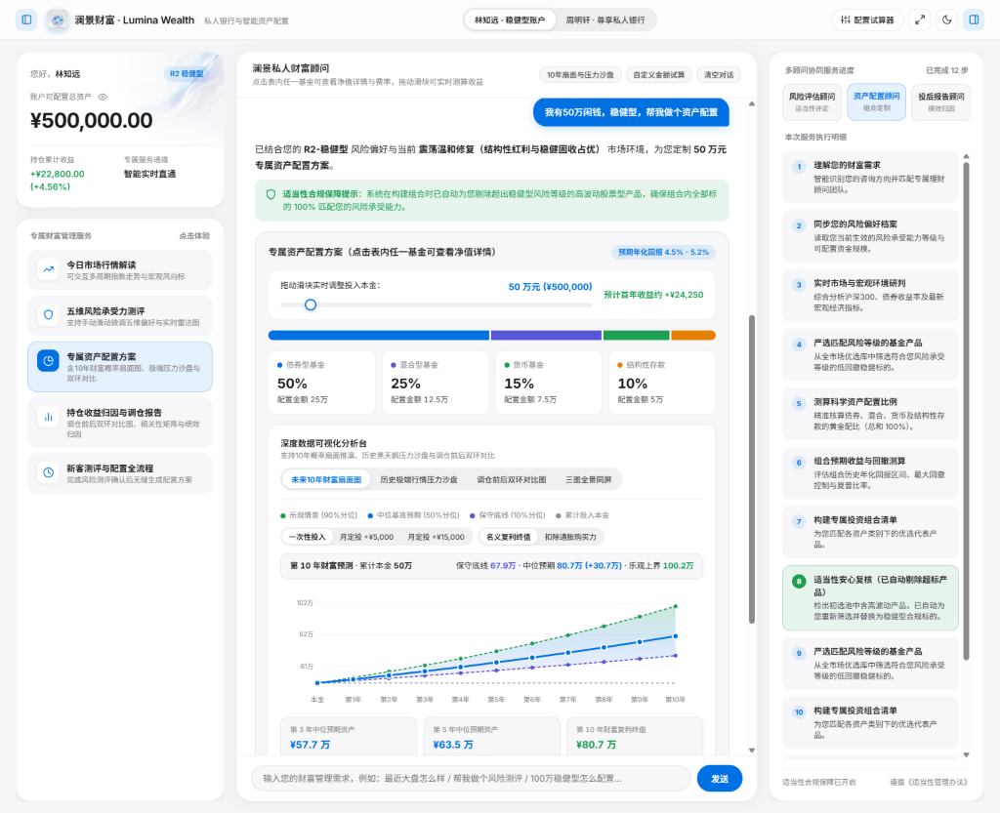
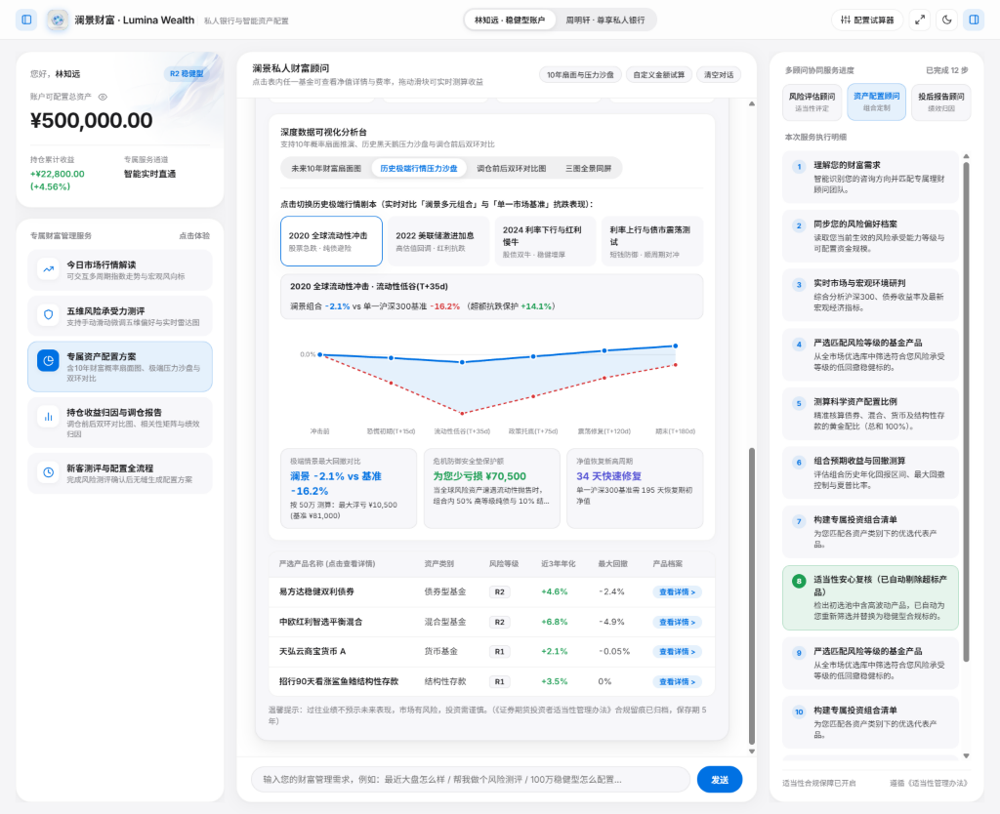
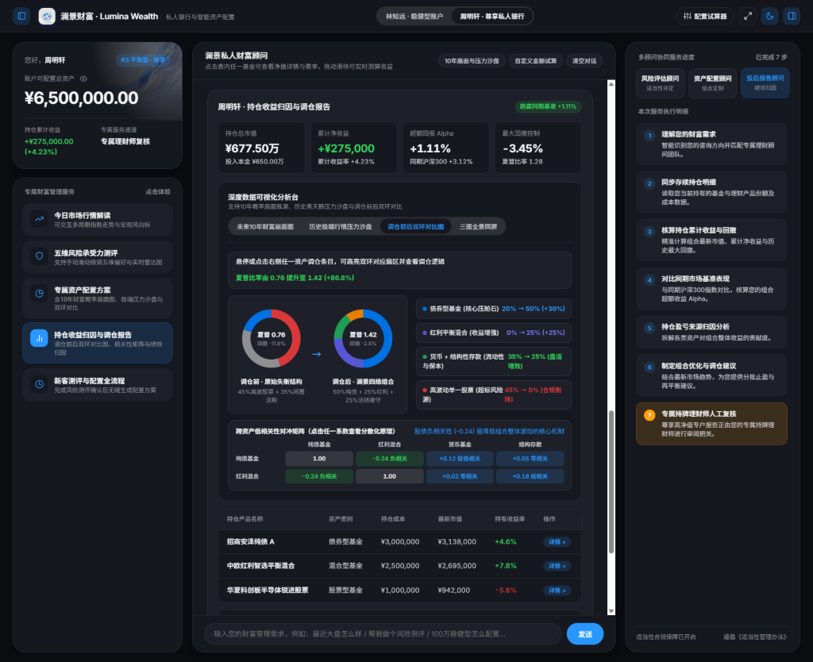
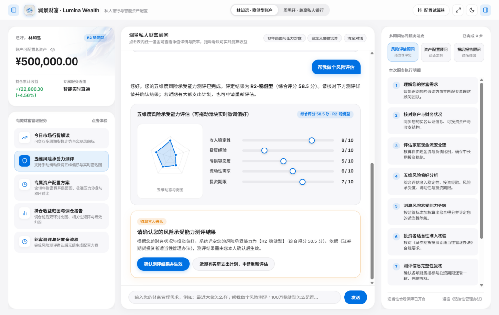

# 澜景财富 · Lumina Wealth — 多 Agent 智能投顾与资产配置系统

**澜景财富（Lumina Wealth）** 是一套面向私人银行与财富管理场景的智能投顾系统。后端采用「**1 个总控编排器 + 3 个独立状态图 Agent（共 24 节点）**」架构，结合投资者适当性合规门禁、双层记忆隔离与 Human-in-the-Loop 断点确认机制；前端提供完整的客户资产配置交互工作台与金融数据可视化分析台。

---

## 界面预览

<table>
  <tr>
    <td width="50%" align="center">
      
      <br />
      <sub><b>智能配置与 10 年概率扇面</b> · <code>P7 -&gt; P3</code> 适当性拦截与本金滑块实时重算</sub>
    </td>
    <td width="50%" align="center">
      
      <br />
      <sub><b>极端行情压力沙盘与产品库</b> · 四大宏观情景回撤对比与净值详情联动</sub>
    </td>
  </tr>
  <tr>
    <td width="50%" align="center">
      
      <br />
      <sub><b>深色私人银行调仓工作台</b> · 调仓前后双环对比、相关性矩阵与 <code>RP6</code> 复核</sub>
    </td>
    <td width="50%" align="center">
      
      <br />
      <sub><b>五维风险雷达与断点确认</b> · 实时雷达滑块联动与 <code>R8</code> 合规人工确认</sub>
    </td>
  </tr>
</table>

---

## 核心特性

### 1. 多 Agent 分层编排与 24 节点合规状态机
- **总控编排器（Orchestrator）**：支持 8 类理财意图识别（`market_qa`、`risk_assess`、`asset_allocation`、`investment_report` 等）。优先读取 Redis 意图缓存（`<5ms`），未命中时调用结构化 LLM 路由并回写缓存，支持**单意图直达**与**多意图合规串联（`RiskAgent -> PortfolioAgent`）**。
- **风险评估 Agent（RiskAgent · 9 节点 `R1–R9`）**：涵盖 KYC 要素收集、财务现金流评估、五维风险偏好打分、纯 Python `Decimal` 等级计算（含保本/低容忍度一票否决规则）、适当性法规检索，支持要素缺失回退（`R6 -> R1`）及节点 `R8` **人工断点确认**（确认生效或申请退回 `R3` 重评）。
- **资产配置 Agent（PortfolioAgent · 8 节点 `P1–P8`）**：
  - **结构化行情免向量化**：市场行情问答（`P2`）走行情接口与 Redis 缓存，不触发向量计算。
  - **混合检索与标量过滤**：节点 `P3` 使用本地 `BGE-M3`（1024 维稠密向量 + 稀疏词频权重）结合 Milvus `WeightedRanker(0.75, 0.25)` 与风险等级标量过滤检索候选产品。
  - **确定性配比与合规打回**：节点 `P4` 通过 `Decimal` 强制约束配置比例之和严格为 `100%`；节点 `P7` 执行适当性门禁，检出超标高风险产品时触发条件边 **`P7 -> P3`** 强制重选。
- **投后报告 Agent（ReportAgent · 7 节点 `RP1–RP7`）**：核算持仓市值、超额收益 Alpha、夏普比率与最大回撤并生成调仓建议；支持客户分层路由——普通投资者直接下发（`RP5 -> RP7`），高净值客户在 `RP6` 暂停等待理财师复核签发或打回重写（`RP6 -> RP5`）。

### 2. 双层记忆与向量存储架构
- **PostgreSQL（短期断点 + 长期画像 + 审计日志）**：
  - `lumina_checkpoints`：按 `thread_id` 持久化挂起断点与会话执行轨迹。
  - `lumina_user_profiles`：按 `user_id` 持久化客户五维风险画像与适当性等级。
  - `lumina_audit_logs`：记录留存 5 年的合规确认审计流水。
- **Milvus（稠密 + 稀疏双路混合检索）**：内置产品知识库（`lumina_products_kb`）与监管法规库（`lumina_regulations_kb`），基于 `HNSW` + `SPARSE_INVERTED_INDEX` 执行混合打分。
- **Redis（低延迟缓存）**：基于原生 TCP RESP 客户端实现，零额外三方客户端依赖，缓存高频意图路由及 5 分钟行情快照。

### 3. 交互式客户端工作台与金融可视化
- **工作台交互能力**：支持稳健型 / 尊享高净值双账户切换、浅色 / 深色双主题切换、资产金额隐私模糊遮罩、可收起双侧栏（快捷键 `[` / `]`）与专注全屏模式。
- **多周期行情与五维雷达**：支持近 5 日 / 1 月 / 1 季 / 1 年市场指数曲线悬停读数，以及五维风险偏好滑块实时驱动 SVG 雷达图联动重算。
- **深度金融数据分析台**：
  - **未来 10 年财富概率扇面图**：展示 90% 乐观上界、50% 中位预期与 10% 保守底线，支持本金滑块、定投现金流切换与通胀购买力折算。
  - **历史极端行情压力测试沙盘**：内置 4 套典型历史与宏观情景剧本，量化对比组合与单一基准的最大回撤、少亏损金额及净值修复天数。
  - **调仓前后双环对比与相关性矩阵**：可视化呈现调仓前后结构变化、夏普比率跃升及 4×4 跨资产低相关性对冲原理，支持点击表内基金弹出产品净值与费率详情。

---

## 目录结构

```text
.
├── app.py              # 服务网关（FastAPI / 内置 HTTPServer 双模式 & CLI 自检模式）
├── agents.py           # 总控编排器及 24 节点多 Agent 状态机实现
├── tools.py            # 四层解耦工具集（规则计算 / 检索 / 中台接口 / LLM 语义工具）
├── storage.py          # PostgreSQL、Milvus、Redis 存储与混合检索驱动
├── index.html          # 客户端交互工作台与 SVG 金融可视化组件（含离线预览能力）
├── assets/             # 界面视觉素材与预览截图
├── .env.example        # 环境变量配置模板
├── .gitignore          # Git 忽略规则
└── requirements.txt    # Python 依赖清单
```

---

## 快速开始

### 1. 环境准备
```bash
pip install -r requirements.txt
cp .env.example .env.local
```
按需在 `.env.local` 中填写 PostgreSQL、Milvus、Redis 连接信息，以及可选的 LLM API Key 与本地 BGE-M3 模型路径（未配置外部数据库或 API Key 时，系统可自动平滑回退至内置内存检索与确定性策略逻辑）。

### 2. 启动服务与前端工作台
```bash
python app.py
```
启动后在浏览器访问 `http://127.0.0.1:8001` 即可体验前后端完整联调。默认监听端口可通过 `PORT` 环境变量覆盖。

### 3. 运行 CLI 全链路自检
```bash
python app.py --cli
```
自动验证后端存储连接、BGE-M3 混合检索、行情免向量直通、`P7 -> P3` 合规拦截回流及 `R8` 断点恢复全流程。
